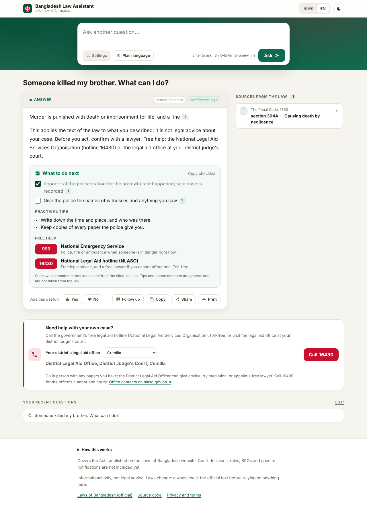
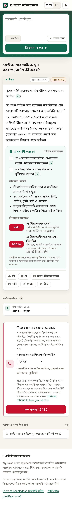
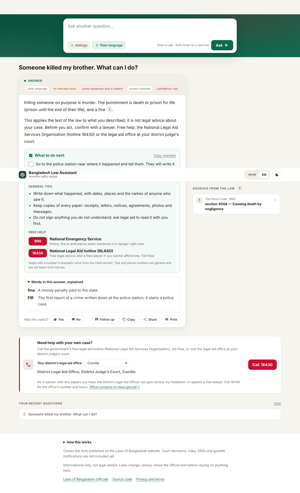

# Next steps, plain language and legal-aid contacts

An answer about someone's situation now ends with something they can act on. This
page says where each part comes from, so a reviewer can tell what is law and what is not.

## What to do next

`answer-system/v6` already asks the model to end a situation answer with numbered steps
under "What you can do" / "আপনি যা করতে পারেন", each cited, and at most three uncited
"Practical tips". [`rag/nextsteps.py`](../src/rag/nextsteps.py) reads those lists back out
of the checked answer, with no second model call, and the service returns them as
`next_steps`:

| part | where it comes from | cited? |
|---|---|---|
| `steps` | the model's numbered steps, after the guardrails ran | yes, `[n]` kept |
| `tips` | the model's practical tips; three fixed tips when it wrote none (`generic_tips: true`) | no, and they may not state law (guardrails `law_in_tips`) |
| `help` | [`rag/legalaid.py`](../src/rag/legalaid.py), picked by the question's topic | no, never written by the model |
| `body` | the answer with the two lists removed, so the page shows each once | as the answer |

Only situations get a checklist: the question reads as advice (`scope.ADVICE`) or names a
situation in the topic table. "What does section 302 say?" and refusals get none. The page
shows the steps as tick boxes (kept in that browser per answer), and the checklist is
included in Copy and Print.

## Plain language

The **Plain language / সহজ ভাষা** switch next to the Ask button sends `plain: true`.
That selects `answer-system/v6-plain`: the whole v6 prompt plus one rule (short
sentences, everyday words, explain an unavoidable legal word in brackets, still cite
every sentence). The guardrails and citation checks are unchanged, and it is still one
model call, which matters on a laptop CPU. Under the answer, a short glossary
([`rag/glossary.py`](../src/rag/glossary.py), 24 terms written by hand in both
languages) explains the legal words the answer actually uses, because a small model
forgets the brackets about as often as it remembers them.

Plain answers are cached apart from normal ones. The deeper-search agent has no plain
variant, so a plain request only uses it when "Deeper search" is ticked.

Not measured yet: the eval runner has no plain switch, and how well gemma4:e4b follows
the extra rule needs a laptop run. Compare a few situation questions with the switch on
and off on the page before relying on it.

## Legal-aid contacts

`GET /legal-aid` returns the hotlines and all 64 district legal aid offices. The help
box on the page has a district picker, remembered in the browser.

| number | service | shown for |
|---|---|---|
| 16430 | National Legal Aid hotline (NLASO), toll-free | every situation |
| 999 | National Emergency Service | rape, murder, assault, threats, trafficking, dowry violence, domestic violence (first when someone may be in danger) |
| 109 | Helpline for violence against women and children | dowry, rape, sexual harassment, domestic violence, child marriage, trafficking |
| 1098 | Child Helpline | child marriage |
| 333 | National information and service line | child marriage |
| 16121 | Consumer rights directorate (DNCRP) | faulty goods, overcharging, adulteration |
| 16357 | Labour inspection helpline (DIFE) | wages, dismissal, maternity leave |

District offices are named, not numbered: each sits at the district judge's court, and
their direct lines change. The page sends people to 16430 or nlaso.gov.bd for the
office's number. A district's number can be added to `DISTRICT_PHONES` once checked.

### Before launch

These numbers were written from public government listings and **have not been checked
by a person yet** (`legalaid.CHECKED` is `None`). Before launch, call or look up each
one on the official site, then set `CHECKED` to the date:

- [ ] 16430 on nlaso.gov.bd
- [ ] 999 (national emergency)
- [ ] 109 on mowca.gov.bd
- [ ] 1098 (Child Helpline, Department of Social Services)
- [ ] 333 (a2i / national information line)
- [ ] 16121 on dncrp.gov.bd
- [ ] 16357 on dife.gov.bd

## Screenshots

Taken with a canned model on the test corpus (`tests/a11y/serve.py` style), so the
answers are illustrations, not real output.

